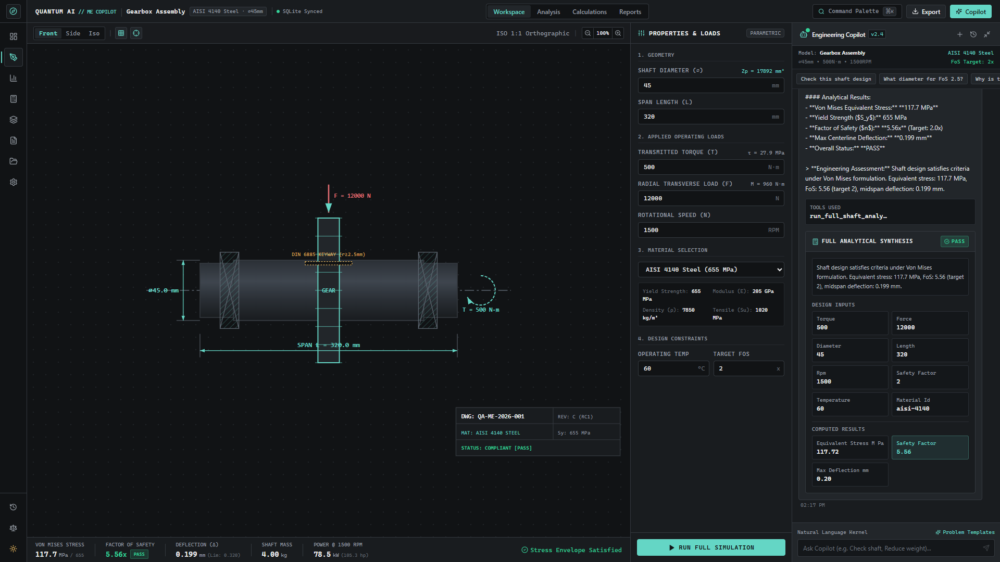
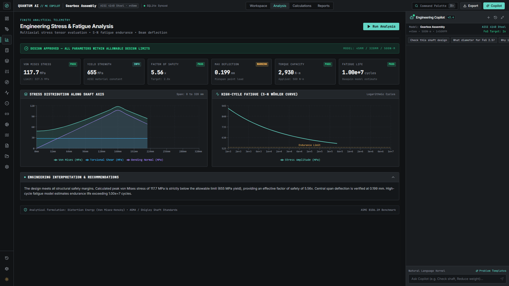
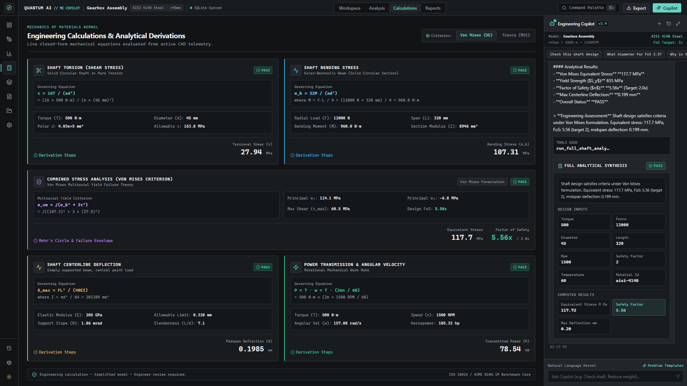

# Mechanical Engineering Copilot

> A traceable, standards-governed engineering copilot bridging generative AI interaction with deterministic machine-element calculations.

[](https://nylp-hackathon-rulebook.lovable.app/)
[](file:///c:/Users/Pc/.gemini/antigravity/scratch/mech-copilot/stage12_comprehensive_verification_report.md)
[](https://www.typescriptlang.org/)
[](https://react.dev/)
[](https://nodejs.org/)

**Mechanical Engineering Copilot** is a specialized design workstation for mechanical engineers, machine designers, and robotics teams sizing rotating shafts, power-transmission elements, and mechanical connections. It couples an interactive browser workstation with an LLM that reasons over engineering intent while routing all physics, stress checks, and standards evaluations to **100% deterministic, closed-form TypeScript calculation engines**.

---

## 1. Problem

Designing rotating machine elements (such as gearbox shafts, pump drives, and motor couplings) is an iterative, error-prone discipline requiring simultaneous compliance with solid mechanics theory and international standards:

* **Multiaxial Stress & Deflection:** Sizing a shaft requires resolving combined torsional shear ($\tau$) and cyclic bending ($\sigma_b$) into equivalent von Mises stresses, while ensuring centerline deflections remain below strict bearing-slope limits ($< 0.1\text{ mm}$ or $L/1000$).
* **Fatigue & Stress Concentrations:** Real shafts incorporate shoulders, keyways, and fillets. Failure to apply accurate geometric stress concentration factors ($K_t$), notch sensitivity ($q$), and Marin endurance modifiers leads to unexpected high-cycle fatigue fractures.
* **Standards Complexity:** Engineers must manually cross-reference standard tables for ISO 286 manufacturing fits, ISO 281 bearing rating lives, DIN 6885-1 keyways, DIN 7190-1 press fits, and ISO 21940-11 rotor balancing.
* **The AI Hallucination Hazard:** Generic LLMs (e.g. ChatGPT, Claude) frequently hallucinate formulas, drop units, misapply equations, or fail static force equilibrium constraints ($\sum F = 0$). Unconstrained generative AI cannot be trusted with safety-critical engineering mathematics.

---

## 2. Solution

**Mechanical Engineering Copilot** resolves the AI reliability problem by enforcing a **strict architectural boundary** between probabilistic language reasoning and deterministic solid mechanics:

1. **Conversational Intent & Orchestration:** The LLM interprets natural language design queries (*"check if this shaft can handle 500 N·m at 1450 RPM"*, *"what diameter is needed for safety factor 2.5?"*), checks parameter completeness, and formulates structured tool requests.
2. **Deterministic Physics Core:** Numerical calculations are never evaluated by the LLM. Instead, the backend executes validated, closed-form TypeScript engines that enforce standard formulas, unit consistency, and physical equilibrium.
3. **Transparent Derivations:** Calculation results return to the copilot as structured JSON, which the assistant presents alongside substituted formulas, safety factors, and interactive UI action buttons.
4. **Interactive CAD Visualization:** The React frontend reflects parameter mutations in real time via an SVG shaft-and-gear assembly visualizer, dynamic Recharts stress distributions, and S-N fatigue endurance curves.

```mermaid
flowchart LR
    User([User / Engineer]) <--> UI[React 18 Workstation\n+ Reactive SVG CAD Viewer]
    UI <--> Express[Express 5 Backend API\n(Boundary Validation & Zod)]
    Express <--> LLM[OpenAI GPT-4o-mini\n(Intent & Tool Orchestrator)]
    Express <--> Fallback[Offline Rule Solver\n(Zero-API-Key Fallback)]
    LLM -- "Structured Tool Calls" --> Physics[Deterministic Engineering Engines\n- Shaft Stress & Deflection\n- Peterson Kt & Goodman Fatigue\n- ISO 281 Bearing Reactions\n- DIN Keys & Press Fits\n- Modal FEA Vibration]
    Fallback --> Physics
    Express <--> DB[(Native node:sqlite DB\nProjects, Checkpoints, Chat)]
```

---

## 3. Features

* **AI-Assisted Engineering Copilot:** Right-docked assistant that parses design intent, executes calculations via tools, and provides clear engineering assessments. Includes an **offline deterministic mode** that functions without an OpenAI API key.
* **Shaft Multiaxial Stress & Deflection:** Closed-form evaluation of pure torsion ($\tau = 16T/\pi d^3$), transverse bending ($M = FL/4$), von Mises equivalent stress ($\sigma_{\text{vm}}$), Tresca shear, and Euler-Bernoulli centerline deflection ($\delta = FL^3/48EI$).
* **Dynamic Fatigue & S-N Curves:** Peterson/Neuber stress concentration factors ($K_t$), notch sensitivity ($q$), fatigue notch factor ($K_f$), Marin endurance factors ($k_a$ through $k_e$), and modified Goodman safety factors for infinite or finite life.
* **Rolling Element Bearings ($L_{10h}$ Life):** ISO 281 dynamic rating life ($L_{10h} = \frac{10^6}{60n}(C/P)^p$), ISO 76 static safety factor ($s_0$), and 3D radial and axial reaction solving with overturning moment equilibrium.
* **Shaft-Hub Connections:** DIN 6885-1 parallel key shear & flank crushing pressure (with reversing load de-rating), DIN 7190-1 cylindrical interference press fits (Lamé thick-wall equations), and thermal shrink-fit assembly temperatures.
* **Cylindrical Gears & Mesh Forces:** ISO 21771-1 external spur and helical gear kinematics, transverse/normal pitch diameters, contact ratio ($> 1.2$), and 3D mesh forces ($F_t, F_r, F_a$) transferring directly into shaft load points.
* **Vibration & Critical Speeds:** 1D Euler-Bernoulli beam modal FEA (consistent mass/stiffness matrices, generalized Jacobi eigensolver), critical speed Campbell diagrams, Jeffcott unbalance response, and ISO 21940-11:2016/Amd 1:2022 rotor balancing grades.
* **Interactive SVG Visualizer:** Technical 2D/3D CAD representation with reactive dimension lines, bearing markers, gear geometry, and live material overlays.
* **Local Persistence & Design Checkpoints:** Embedded SQLite database (`node:sqlite`) with automated schema migrations, project snapshots, version diff comparison, and rollback.

> **Scope & Limitations:** Calculations rely on closed-form beam, plate, and thick-cylinder solid mechanics. The system does not perform non-linear solid plasticity, 3D continuum FEA meshing, or CFD. Results are preliminary engineering sizing aids and do not substitute for formal Professional Engineer (PE) certification or physical testing.

---

## 4. Tech Stack

| Layer | Technology | Role in System |
| :--- | :--- | :--- |
| **Frontend** | React 18.3.1, TypeScript 5.7 | Component architecture, application state, and typed UI bindings. |
| **Build & Tooling** | Vite 6.0.7, Tailwind CSS 3.4 | Development server, fast HMR, and utility-first styling. |
| **Visualizations** | SVG, Recharts 2.15, Lucide React | Reactive CAD geometry rendering, stress area charts, and S-N curves. |
| **Backend API** | Node.js (v22+), Express 5.2 | REST endpoints (`/api/projects`, `/api/chat`), CORS, and error handling. |
| **Persistence** | Native `node:sqlite` | Zero-dependency, C-speed embedded SQLite database with schema migrations. |
| **AI Integration** | OpenAI SDK 7.20 (`gpt-4o-mini`) | Language understanding, prompt guardrails, and structured function calling. |
| **Validation** | Zod 4.6.5 | Runtime schema enforcement for API payloads and environment variables. |
| **Testing** | Node Test Runner (`tsx --test`), Playwright | Unit, integration, and end-to-end browser verification. |

---

## 5. AI / API Usage

The system architecture cleanly separates nondeterministic language orchestration from numerical evaluation:

* **Model Configuration:** Configured to use `gpt-4o-mini` by default (customizable via `OPENAI_MODEL` in `.env`).
* **Prompt Guardrails (`server/services/llm.ts`):** The system prompt instructs the assistant:
  > *"Use the available engineering tools whenever the user asks for a calculation that those tools can perform. Do not invent engineering calculations when a deterministic tool exists. Do not fabricate numerical results."*
* **Tool Calling Schema:** Two primary tools are exposed via OpenAI Function Calling:
  1. `calculate_required_shaft_diameter`: Accepts torque, material yield strength, and target safety factor $\to$ computes exact minimum diameter via Tresca criterion.
  2. `run_full_shaft_analysis`: Accepts 3D load vectors, geometry, RPM, and material properties $\to$ evaluates equivalent stress, bending moments, deflection, and pass/fail status.
* **Deterministic Execution Flow:** When the LLM emits a tool call, the backend intercepts the JSON arguments, executes the corresponding TypeScript engine in `src/engineering`, and returns the verified numerical result to the LLM. The LLM then formats the final conversational response referencing the authoritative calculation.
* **Zero-API-Key Offline Fallback:** If `OPENAI_API_KEY` is omitted, `processOfflineChatRequest` intercepts incoming queries, executes pattern-matched deterministic tools, and returns LaTeX-formatted engineering responses with identical result cards.

---

## 6. Setup Instructions

### Prerequisites
* **Node.js:** v22.0.0 or higher (v22.20+ or v24.x recommended for native `node:sqlite`)
* **npm:** v10.0.0 or higher
* **Git:** Installed in your terminal

### Installation Steps

1. **Clone the repository:**
   ```bash
   git clone https://github.com/Fawadullah15/mech-copilot.git
   cd mech-copilot
   ```

2. **Install dependencies:**
   ```bash
   npm install
   ```

3. **Configure environment variables:**
   ```bash
   # Windows PowerShell
   Copy-Item .env.example .env

   # Linux / macOS
   cp .env.example .env
   ```
   *(Optional)* Add your `OPENAI_API_KEY` in `.env`. If left empty, the application automatically runs in full offline deterministic mode.

4. **Initialize and seed the database:**
   ```bash
   npm run db:seed
   ```
   *Creates `data/mech-copilot.db` and provisions a default "Gearbox Assembly" project with baseline design parameters.*

5. **Start the application:**
   ```bash
   npm run dev
   ```
   *Runs the Vite client (`http://localhost:5173`) and Express server (`http://localhost:3001`) concurrently.*

6. **Verify the Main Workflow:**
   * Open `http://localhost:5173` and click the **Gearbox Assembly** project.
   * Modify the shaft diameter or torque in the right-hand panel and observe the SVG CAD visualizer update live.
   * Open the **Engineering Copilot** panel on the right.
   * Enter: `"What diameter do I need for FoS 2.5?"`
   * Observe the structured **Engineering Result Card** returned by the tool, click **"Apply"** to update your design parameters, and refresh the browser to verify database persistence.

For a guided walkthrough, refer to [docs/demo-script.md](docs/demo-script.md). For schema details, see [docs/database.md](docs/database.md).

### Verification & Testing Commands

```bash
# Run complete automated test suite (214 tests across engineering, server, and client)
npm test

# Run multi-stage physical integration workflows (Gears -> Loads -> Fatigue -> Balancing)
npx tsx scripts/verify-all-workflows.ts

# Run production build compilation
npm run build
```

---

## 7. Screenshots

| View | Screenshot | Description |
| :--- | :---: | :--- |
| **Interactive CAD Workspace** |  | Reactive 2D/3D SVG visualizer with live dimension callouts, material overlay, and parameter controls. |
| **Dynamic Analysis & S-N Curves** |  | Recharts stress distribution areas and logarithmic S-N fatigue endurance life curves. |
| **Engineering Calculation Cards** |  | Transparent mathematical derivation cards with substituted variables, formulas, and safety margins. |
| **AI Copilot Tool Execution** |  | Docked Engineering Copilot executing deterministic tool calls and rendering structured recommendation cards. |

---

## Team Contributions

* **Fawadullah Imraj:** Team Lead, Product Direction and AI Integration.
* **Fahad Khan:** Technical Lead, Backend and System Architecture.
* **Laiba Ikram:** UI/UX Design and User Research.
* **Ujala Gull:** Documentation and Presentation.
* **Noor Us Saba:** Research, Testing and Quality Assurance.
* **Ayesha Khan:** Frontend Development and User Experience.

> [!NOTE]
> **Team Eligibility Review Note:**
> The project team contains six members as listed above. Section 3 of the NYLP AI Hackathon 2026 Rulebook stipulates a maximum of 5 members per team, and the official submission form dropdown enforces this limit. This discrepancy is flagged for confirmation by the Team Lead with the hackathon organizing committee prior to final submission.
