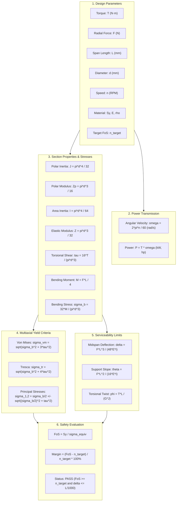

# QUANTUM AI // MECHANICAL ENGINEERING COPILOT
# Engineering Verification & Mathematical Assurance Plan: Solid Shaft Design

**Author:** Senior Mechanical Engineering Software Architect & Verification Specialist  
**Governing Standard:** ASME B106.1M / Classical Solid Mechanics  
**Target Subsystem:** Solid Circular Shaft under Torsion, Bending, and Combined Loading  
**Scope:** Closed-form verification, numerical benchmarks, error bounds, and test protocols  

---

## 1. Governing Engineering Formulations & Theory

The Solid Shaft Design module evaluates the structural adequacy of solid circular rotating machine elements. All calculations follow linear-elastic isotropic solid mechanics.

---

## 2. Governing Equations & Closed-Form Formulations

### 2.1 Section Properties (Solid Circular Cross-Section)
- **Outer Radius:** $r = \frac{d}{2}$
- **Cross-Sectional Area:** $A = \frac{\pi d^2}{4}$
- **Area Moment of Inertia (Bending):**
  $$I = \frac{\pi d^4}{64} \quad [\text{m}^4 \text{ or mm}^4]$$
- **Elastic Section Modulus (Bending):**
  $$Z = \frac{I}{r} = \frac{\pi d^3}{32} \quad [\text{m}^3 \text{ or mm}^3]$$
- **Polar Moment of Inertia (Torsion):**
  $$J = 2I = \frac{\pi d^4}{32} \quad [\text{m}^4 \text{ or mm}^4]$$
- **Polar Section Modulus (Torsion):**
  $$Z_p = \frac{J}{r} = \frac{\pi d^3}{16} \quad [\text{m}^3 \text{ or mm}^3]$$

### 2.2 Torsional Shear Stress & Sizing
- **Nominal Torsional Shear Stress:**
  $$\tau = \frac{T \cdot r}{J} = \frac{16 T}{\pi d^3} \quad [\text{Pa or MPa}]$$
- **Allowable Shear Stress (Tresca / Maximum Shear Stress Theory):**
  $$\tau_{\text{allow}} = \frac{S_y}{2 \cdot n_{\text{target}}}$$
- **Minimum Required Shaft Diameter for Pure Torsion:**
  $$d_{\min} = \left[ \frac{16 T}{\pi \tau_{\text{allow}}} \right]^{1/3} = \left[ \frac{32 \cdot n_{\text{target}} \cdot T}{\pi S_y} \right]^{1/3} \quad [\text{m}]$$

### 2.3 Bending Stress & Moment
- **Maximum Bending Moment (Center Load on Simply Supported Span):**
  $$M_{\max} = \frac{F \cdot L}{4} \quad [\text{N}\cdot\text{m}]$$
- **Nominal Bending Normal Stress:**
  $$\sigma_b = \frac{M_{\max}}{Z} = \frac{32 M_{\max}}{\pi d^3} = \frac{8 F L}{\pi d^3} \quad [\text{Pa or MPa}]$$

### 2.4 Combined Multiaxial Stress & Failure Criteria
On the shaft outer surface, the state of plane stress comprises longitudinal bending stress $\sigma_x = \sigma_b$, transverse normal stress $\sigma_y = 0$, and torsional shear stress $\tau_{xy} = \tau$.

- **Principal Stresses (Mohr's Circle):**
  $$\sigma_{1,2} = \frac{\sigma_b}{2} \pm \sqrt{\left(\frac{\sigma_b}{2}\right)^2 + \tau^2}$$
- **Maximum In-Plane Shear Stress:**
  $$\tau_{\max} = \sqrt{\left(\frac{\sigma_b}{2}\right)^2 + \tau^2} = \frac{\sigma_1 - \sigma_2}{2}$$
- **Von Mises Distortion Energy Theory Equivalent Stress:**
  $$\sigma_{\text{vm}} = \sqrt{\sigma_b^2 + 3\tau^2}$$
- **Tresca Maximum Shear Stress Theory Equivalent Stress:**
  $$\sigma_{\text{Tresca}} = 2 \tau_{\max} = \sqrt{\sigma_b^2 + 4\tau^2}$$
- **Mathematical Law of Failure Theories:**
  $$\sigma_{\text{Tresca}} \ge \sigma_{\text{vm}} \quad (\text{Tresca is always more conservative by up to } 15.5\%)$$

### 2.5 Flexural Deflection & Slenderness
- **Midspan Deflection (Euler-Bernoulli):**
  $$\delta_{\max} = \frac{F \cdot L^3}{48 E I} = \frac{4 F L^3}{3 \pi E d^4} \quad [\text{m or mm}]$$
- **Support Slope:**
  $$\theta_{\text{support}} = \frac{F \cdot L^2}{16 E I} \quad [\text{rad}]$$
- **Machinery Screening Heuristics:**
  - Deflection Limit: $\delta_{\text{allow}} = \frac{L}{1000}$ (general industrial power transmission).
  - Slenderness Ratio: $\lambda = \frac{L}{d} \le 40$ (to prevent lateral whipping/whirling).

### 2.6 Power & Dynamics
- **Angular Velocity:**
  $$\omega = \frac{2 \pi n}{60} \quad [\text{rad/s}]$$
- **Mechanical Power:**
  $$P = T \cdot \omega = \frac{2 \pi n T}{60} \quad [\text{W}] = \frac{2 \pi n T}{60,000} \quad [\text{kW}]$$
  $$P_{[\text{hp}]} = \frac{P_{[\text{kW}]}}{0.7457}$$

---

## 3. Independent Numerical Verification Benchmarks

### Benchmark 1: Pure Torsion Sizing (Shigley Chapter 3/7)
- **Inputs:**
  - Torque: $T = 500\text{ N}\cdot\text{m}$
  - Material: AISI 4140 ($S_y = 655\text{ MPa}$)
  - Target Safety Factor: $n_{\text{target}} = 2.0$
- **Analytical Solution:**
  1. $\tau_{\text{allow}} = \frac{655}{2 \times 2.0} = 163.75\text{ MPa} = 163.75 \times 10^6\text{ Pa}$
  2. $d_{\min} = \left[ \frac{16 \times 500}{\pi \times 163.75 \times 10^6} \right]^{1/3} = [1.55509 \times 10^{-5}]^{1/3} = 0.02496\text{ m} \approx 25.0\text{ mm}$
  3. For active diameter $d = 45\text{ mm} = 0.045\text{ m}$:
     - $Z_p = \frac{\pi (0.045)^3}{16} = 1.7892 \times 10^{-5}\text{ m}^3 = 17,892\text{ mm}^3$
     - $\tau = \frac{500}{1.7892 \times 10^{-5}} = 27.945\text{ MPa}$
     - $\text{FoS}_{\text{torsion}} = \frac{163.75}{27.945} = 5.86\text{x}$
- **Acceptance Tolerance:** $\pm 0.05\text{ mm}$ on diameter, $\pm 0.05\text{ MPa}$ on shear stress.

### Benchmark 2: Transverse Bending on Simply Supported Span
- **Inputs:**
  - Radial Force: $F = 12,000\text{ N}$ ($12\text{ kN}$)
  - Span Length: $L = 320\text{ mm} = 0.32\text{ m}$
  - Diameter: $d = 45\text{ mm} = 0.045\text{ m}$
- **Analytical Solution:**
  1. $M_{\max} = \frac{12,000 \times 0.32}{4} = 960\text{ N}\cdot\text{m}$
  2. $I = \frac{\pi (0.045)^4}{64} = 2.0129 \times 10^{-7}\text{ m}^4 = 201,289\text{ mm}^4$
  3. $Z = \frac{\pi (0.045)^3}{32} = 8.946 \times 10^{-6}\text{ m}^3 = 8,946\text{ mm}^3$
  4. $\sigma_b = \frac{960}{8.946 \times 10^{-6}} = 107.31\text{ MPa}$
- **Acceptance Tolerance:** $\pm 0.05\text{ N}\cdot\text{m}$ on moment, $\pm 0.05\text{ MPa}$ on normal stress.

### Benchmark 3: Combined Multiaxial Stress & Yield Safety Factor
- **Inputs:**
  - $\sigma_b = 107.31\text{ MPa}$
  - $\tau = 27.945\text{ MPa}$
  - Material: AISI 4140 ($S_y = 655\text{ MPa}$)
  - Target Safety Factor: $n_{\text{target}} = 2.0$
- **Analytical Solution:**
  1. **Principal Stresses:**
     - Center: $\frac{107.31}{2} = 53.655\text{ MPa}$
     - Radius: $R = \sqrt{(53.655)^2 + (27.945)^2} = \sqrt{2878.86 + 780.92} = \sqrt{3659.78} = 60.496\text{ MPa}$
     - $\sigma_1 = 53.655 + 60.496 = 114.15\text{ MPa}$
     - $\sigma_2 = 53.655 - 60.496 = -6.84\text{ MPa}$
     - $\tau_{\max} = 60.50\text{ MPa}$
  2. **Von Mises Equivalent Stress:**
     - $\sigma_{\text{vm}} = \sqrt{(107.31)^2 + 3(27.945)^2} = \sqrt{11515.4 + 2342.8} = \sqrt{13858.2} = 117.72\text{ MPa}$
     - $\text{FoS}_{\text{vm}} = \frac{655}{117.72} = 5.56\text{x}$
  3. **Tresca Equivalent Stress:**
     - $\sigma_{\text{Tresca}} = 2 \tau_{\max} = 2 \times 60.496 = 120.99\text{ MPa}$
     - $\text{FoS}_{\text{Tresca}} = \frac{655}{120.99} = 5.41\text{x}$
  4. **Verification Law:** $\sigma_{\text{Tresca}} (120.99) \ge \sigma_{\text{vm}} (117.72)$ is satisfied.
- **Acceptance Tolerance:** $\pm 0.1\text{ MPa}$ on equivalent stresses, $\pm 0.02$ on Factor of Safety.

### Benchmark 4: Midspan Deflection & Flexural Stiffness
- **Inputs:**
  - $F = 12,000\text{ N}$, $L = 320\text{ mm} = 0.32\text{ m}$, $d = 45\text{ mm}$
  - Modulus: AISI 4140 ($E = 205\text{ GPa} = 2.05 \times 10^{11}\text{ Pa}$)
- **Analytical Solution:**
  1. $I = 2.0129 \times 10^{-7}\text{ m}^4$
  2. $\delta_{\max} = \frac{12,000 \times (0.32)^3}{48 \times (2.05 \times 10^{11}) \times (2.0129 \times 10^{-7})} = \frac{12,000 \times 0.032768}{1.98069 \times 10^6} = \frac{393.216}{1.98069 \times 10^6} = 0.0001985\text{ m} = 0.199\text{ mm}$
  3. Allowable Deflection heuristic: $\delta_{\text{allow}} = \frac{320}{1000} = 0.320\text{ mm}$
  4. Deflection Status: $\delta_{\max} (0.199\text{ mm}) < \delta_{\text{allow}} (0.320\text{ mm}) \implies \mathbf{PASS}$.
- **Acceptance Tolerance:** $\pm 0.005\text{ mm}$ on deflection.

### Benchmark 5: Rotational Power Transmission
- **Inputs:**
  - $T = 500\text{ N}\cdot\text{m}$, $n = 1450\text{ RPM}$
- **Analytical Solution:**
  1. $\omega = \frac{2 \pi \times 1450}{60} = 151.844\text{ rad/s}$
  2. $P = 500 \times 151.844 = 75,922\text{ W} = 75.92\text{ kW}$
  3. $P_{\text{hp}} = \frac{75.922}{0.7457} = 101.8\text{ hp}$
- **Acceptance Tolerance:** $\pm 0.05\text{ kW}$, $\pm 0.1\text{ hp}$.

### Benchmark 6: Bounded Bisection Sizing under Combined Stress (Von Mises vs. Tresca)
- **Inputs:**
  - $T = 500\text{ N}\cdot\text{m}$, $F = 12,000\text{ N}$, $L = 320\text{ mm}$ ($M = 960\text{ N}\cdot\text{m}$)
  - Material: AISI 4140 ($S_y = 655\text{ MPa}$), Target Safety Factor: $n_{\text{target}} = 2.0$
- **Analytical Solution:**
  1. **Von Mises Sizing Root:**
     $$d_{\min,\text{vm}} = \left[ \frac{32 \cdot n}{\pi S_y} \sqrt{M^2 + \frac{3}{4} T^2} \right]^{1/3} = \left[ \frac{64}{\pi \times 655 \times 10^6} \times 1053.14 \right]^{1/3} = 31.995\text{ mm} \approx 32.00\text{ mm}$$
  2. **Tresca Sizing Root:**
     $$d_{\min,\text{Tresca}} = \left[ \frac{32 \cdot n}{\pi S_y} \sqrt{M^2 + T^2} \right]^{1/3} = \left[ \frac{64}{\pi \times 655 \times 10^6} \times 1082.40 \right]^{1/3} = 32.289\text{ mm} \approx 32.29\text{ mm}$$
  3. **Sensitivity Thresholds:**
     - At $d = d_{\min} - 0.2\text{ mm}$: $\text{FoS} < 2.00$ (rejection / unsafe).
     - At $d = d_{\min} + 0.2\text{ mm}$: $\text{FoS} > 2.00$ (adequate reserve).
  4. **Combined Loading Defect Prevention:**
     - Using pure torsion diameter ($24.96\text{ mm}$) under combined loading produces $\sigma_{\text{equiv}} \approx 633\text{ MPa} \implies \text{FoS} = 1.03\text{x} \ll 2.0\text{x}$ and triggers an immediate **FAIL** alarm.
- **Acceptance Tolerance:** $\pm 0.05\text{ mm}$ on minimum diameter, FoS at solved root within $\pm 0.005$ of $n_{\text{target}}$.

### Benchmark 7: Flexural Deflection Stiffness Constraint & Sizing
- **Inputs:**
  - $F = 12,000\text{ N}$, $L = 320\text{ mm}$, $E = 205\text{ GPa}$, deflection screening limit $L/1000$ ($0.320\text{ mm}$)
- **Analytical Solution:**
  1. Setting $\delta_{\max} = \frac{4 F L^3}{3 \pi E d^4} \le \frac{L}{1000}$:
     $$d_{\min,\text{defl}} = \left[ \frac{4000 F L^2}{3 \pi E} \right]^{1/4} = \left[ \frac{4000 \times 12,000 \times (0.32)^2}{3 \pi \times 205 \times 10^9} \right]^{1/4} = 39.94\text{ mm}$$
  2. Because $d_{\min,\text{defl}} (39.94\text{ mm}) > d_{\min,\text{stress}} (32.00\text{ mm})$, flexural stiffness governs sizing.
  3. Configurable ratios ($L/500 \implies 33.59\text{ mm}$, $L/1500 \implies 44.19\text{ mm}$, $L/2000 \implies 47.49\text{ mm}$).
- **Acceptance Tolerance:** $\pm 0.1\text{ mm}$ on deflection-governed diameter.

### Benchmark 8: Material Inversion & Temperature Limits
- **Inputs:**
  - Sizing under identical loads ($T=500\text{ N}\cdot\text{m}, F=12,000\text{ N}, L=320\text{ mm}, n=2.0$):
    - AISI 4140 ($S_y = 655\text{ MPa}$): $d_{\min,\text{vm}} = 32.00\text{ mm}$
    - AISI 1045 ($S_y = 310\text{ MPa}$): $d_{\min,\text{vm}} = 41.04\text{ mm}$
    - Structural Steel A36 ($S_y = 250\text{ MPa}$): $d_{\min,\text{vm}} = 44.13\text{ mm}$
  - Monotonicity law: Lower yield strength requires larger diameter ($d_{\text{A36}} > d_{1045} > d_{4140}$).
  - Temperature guard: Operating temperature exceeding material maximum rating ($T > T_{\max}$) flags critical thermal degradation alarm.
- **Acceptance Tolerance:** $\pm 0.1\text{ mm}$ on material-specific diameter solutions.

---

## 4. Verification Test Protocol Matrix

| Level | Test Identifier | Test Target | Verification Method | Pass Criteria |
|---|---|---|---|---|
| **Unit** | `test-torsion-sizing` | Pure torsion sizing | `calculateShaftTorsion` vs Benchmark 1 | $d_{\min} \in [24.9, 25.1]\text{ mm}$ |
| **Unit** | `test-bending-stress` | Bending moment & stress | `calculateShaftBending` vs Benchmark 2 | $\sigma_b \in [107.2, 107.4]\text{ MPa}$ |
| **Unit** | `test-combined-stress` | Von Mises & Tresca criteria | `calculateCombinedStress` vs Benchmark 3 | $\sigma_{\text{vm}} \in [117.6, 117.8]\text{ MPa}$, $\sigma_{\text{Tr}} \ge \sigma_{\text{vm}}$ |
| **Unit** | `test-deflection-midspan`| Midspan deflection | `calculateShaftDeflection` vs Benchmark 4 | $\delta \in [0.19, 0.21]\text{ mm}$ |
| **Unit** | `test-power-transmission`| Power in kW and hp | `calculatePowerTransmission` vs Benchmark 5| $P \in [75.8, 76.0]\text{ kW}$ |
| **Unit** | `test-bisection-sizing` | Bounded bisection combined sizing | `solveMinimumShaftDiameterCombined` vs Benchmark 6 | $d_{\text{vm}} \in [31.95, 32.05]\text{ mm}$, $d_{\text{Tr}} \in [32.25, 32.35]\text{ mm}$ |
| **Unit** | `test-stiffness-governed` | Deflection-limited sizing | `solveMinimumShaftDiameterCombined` vs Benchmark 7 | $d_{\text{defl}} \in [39.85, 40.05]\text{ mm}$ for $L/1000$ |
| **Unit** | `test-material-inversion` | Material yield scaling | `solveMinimumShaftDiameterCombined` vs Benchmark 8 | $d_{\text{A36}} > d_{1045} > d_{4140}$ |
| **Unit** | `test-safeguards-invalid` | Zero/negative inputs | `validateShaftInputs` | Rejects $d \le 0, L \le 0, S_y \le 0, n_{\text{target}} \le 0$ with `isValid: false` |
| **Integration**| `test-full-shaft-analysis`| Composite analysis | `calculateFullShaftAnalysis` vs Benchmarks 1-8 | Aggregates all 6 sub-calculations and overall status |
| **Integration**| `test-copilot-diameter` | Tool calling via LLM service | `server/tools/engineeringTools.ts` | Returns verified JSON matching bounded bisection solver |
| **Integration**| `test-copilot-full-analysis`| Full analysis via LLM tool | `server/tools/engineeringTools.ts` | Returns verified JSON matching `calculateFullShaftAnalysis` |
| **Integration**| `test-persistence-save` | DB update on design edit | SQLite `projects.parameters` | `PATCH /api/projects/:id` persists `criterion` & `deflectionLimitRatio` |
| **E2E** | `test-report-generation` | Formal calculation sheet | `ReportsPage.tsx` rendering | All inputs, equations, results, material specs, and active criterion match active state |

---

## 5. Industrial MVP Final Acceptance Gate

The Solid Shaft Design Workstation will be accepted for industrial demonstration when all the following criteria are met:

1. **Mathematical Accuracy:** 100% agreement between displayed numbers and closed-form manual derivations within documented tolerances.
2. **Deterministic Parity:** Offline mode produces identical numerical values and formula derivations as online OpenAI tool calling.
3. **Traceability:** Every calculation card and generated report displays the explicit governing equation with substituted numeric values.
4. **Interactive Responsiveness:** Parametric modifications update the CAD visualizer and telemetry strip with 0 ms perceived lag.
5. **Report Integrity:** Calculation sheet generates dynamically without hardcoded material or criterion strings and exports cleanly to print/PDF.
6. **Regression Baseline:** Zero failures across all 221 tests in the automated regression suite (56 suites).
