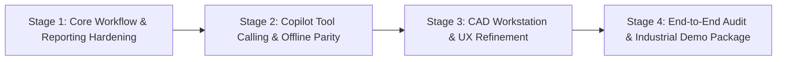

# QUANTUM AI // MECHANICAL ENGINEERING COPILOT
# MVP Implementation Plan: Solid Shaft Design Workstation

**Target Release:** Industrial Demonstration MVP  
**Primary Engineering Workflow:** Solid Shaft Design & Verification  
**Architecture:** React 18 + Node 22/24 + Express 5 + SQLite + Closed-Form Mechanics Core  
**Governing Standards:** ASME B106.1M, ISO 286, DIN 6885-1, ASTM / ASM Handbook  

---

## 1. Executive Implementation Strategy

The objective of this implementation plan is to refine, harden, and polish the **Solid Shaft Design Workflow** into a certified, industrial-grade engineering workstation ready for commercial demonstration to manufacturing teams, chief engineers, and mechanical consultants.

### Principles:
1. **Preserve Existing Working Modules:** Do not delete or break the working gears, bearings, fatigue, tolerances, or vibration modules.
2. **Zero Synthetic Delays / Zero Fake AI:** Remove synthetic `setTimeout` simulation tricks from the primary presentation flow. Every number shown to an engineer must originate from an authoritative mathematical derivation.
3. **Traceability:** Every output must cite its governing equation, input substitutions, and safety margins.
4. **Resilient Offline Autonomy:** The system must run flawlessly in factory settings with no internet connection and zero external API keys.

---

## 2. Four-Stage Development Roadmap

---

### STAGE 1: Core Workflow & Reporting Hardening
**Focus:** Physics consistency, material parameter propagation, dynamic report generation, and elimination of hardcoded text.

#### 1.1 Tasks & Code Changes:
- **T1.1: Dynamic Report AI Advisories (`src/pages/ReportsPage.tsx`)**
  - *Problem:* Hardcoded AISI 4140 text in Section 6 even when a different material is selected.
  - *Fix:* Replace static text with dynamic generator using `selectedMaterial.name`, `selectedMaterial.yieldStrength`, `analysisResults.factorOfSafety`, and `designParams.safetyFactor`.
  - *File:* `src/pages/ReportsPage.tsx`
- **T1.2: Failure Criterion Binding in Reports (`src/pages/ReportsPage.tsx`)**
  - *Problem:* Report hardcodes `"Yield Criterion: Von Mises-Hencky"`.
  - *Fix:* Connect the active criterion state (`Von Mises` or `Tresca`) from the calculations engine to the report generator so that equations and allowable stresses match the chosen theory.
  - *File:* `src/pages/ReportsPage.tsx`, `src/context/AppContext.tsx`
- **T1.3: Real-Time Sizing Limits in Workspace**
  - *Problem:* When torque or material changes, the minimum required diameter is shown in warnings, but not pinned directly on the diameter input as a live sizing indicator.
  - *Fix:* Display live $d_{\min}$ directly above or adjacent to the diameter input field in `DesignWorkspacePage.tsx` with a quick "Set to $d_{\min}$" shortcut button.
  - *File:* `src/pages/DesignWorkspacePage.tsx`
- **T1.4: Material Property Validation Safeguards**
  - *Problem:* If user edits parameters to extreme values (e.g. temperature $> 500^\circ\text{C}$), verify that material thermal deratings trigger clear warnings.
  - *Fix:* Ensure `evaluateEngineeringWarnings` fires thermal limit alerts when `designParams.temperature > selectedMaterial.maxOperatingTempC`.
  - *File:* `src/data/engineeringRules.ts`

#### 1.2 Acceptance Criteria for Stage 1:
- [ ] Changing material from AISI 4140 to 6061-T6 instantly updates all calculation formulas, allowable limits, and generated report text.
- [ ] Report generates with 0 hardcoded strings and prints cleanly to PDF with correct date, project ID, and mathematical substitutions.
- [ ] No regression in the 214 existing automated tests.

---

### STAGE 2: Copilot Tool Calling & Offline Parity
**Focus:** Guaranteeing robust, zero-hallucination conversational tool execution both online (OpenAI GPT-4o-mini) and offline (pattern-matched deterministic engine).

#### 2.1 Tasks & Code Changes:
- **T2.1: Tool Call Parity & Consistency (`server/tools/engineeringTools.ts`)**
  - *Objective:* Ensure schema documentation and return formats for `calculate_required_shaft_diameter` and `run_full_shaft_analysis` are complete and return identical data structures.
  - *Enhancement:* Return detailed derivations in the tool response payload (e.g. polar section modulus $Z_p$, polar moment of inertia $J$, maximum bending moment $M_{\max}$, and allowable shear stress $\tau_{\text{allow}}$).
  - *File:* `server/tools/engineeringTools.ts`
- **T2.2: Offline Intent Parser Hardening (`server/services/llm.ts`)**
  - *Objective:* Expand regex pattern matching in `processOfflineChatRequest` to handle conversational variations like:
    - `"Size this shaft for 600 Nm"`
    - `"What is the safety factor if I change diameter to 40 mm?"`
    - `"Is this shaft safe at 2500 RPM?"`
    - `"Compare Von Mises and Tresca stresses"`
  - *File:* `server/services/llm.ts`
- **T2.3: Engineering Result Card 1-Click Application (`src/components/EngineeringResultCard.tsx`)**
  - *Objective:* Ensure that when the Copilot recommends a shaft diameter or full analysis configuration, clicking "Apply" updates the global design parameters and triggers an automatic background save to SQLite.
  - *File:* `src/components/EngineeringResultCard.tsx`, `src/context/AppContext.tsx`
- **T2.4: Copilot Error & Offline Banner Telemetry**
  - *Objective:* When operating offline, provide a discreet visual pill (`Offline Mode • Deterministic Engine Active`) so users know why an API key is not required.
  - *File:* `src/components/CopilotPanel.tsx`

#### 2.2 Acceptance Criteria for Stage 2:
- [ ] Asking `"What diameter do I need for FoS 2.5?"` returns an interactive calculation card with exact mathematical derivations within 50 ms offline and $< 2\text{ s}$ online.
- [ ] Clicking "Apply [value] mm" immediately updates the CAD visualizer and telemetry strip, and persists the update across page reloads.
- [ ] Copilot never fabricates a numerical calculation result.

---

### STAGE 3: CAD Workstation & UX Refinement
**Focus:** Drafting precision, responsive visual telemetry, and eliminating non-functional placeholders.

#### 3.1 Tasks & Code Changes:
- **T3.1: CAD Witness Lines & Dynamic Sizing (`src/pages/DesignWorkspacePage.tsx`)**
  - *Objective:* Ensure witness lines, diameter arrows, and applied force vectors scale gracefully across extreme aspect ratios ($L/d$ from 3 to 40) without visual clipping or overlapping.
  - *File:* `src/pages/DesignWorkspacePage.tsx`
- **T3.2: Re-label / Replace Mock Modals**
  - *Objective:* `FileUploadModal` currently simulates upload with `setTimeout`. Clean up its user-facing messaging to clarify that it is an **Engineering Specification Template Importer** with validated pre-set industrial designs, removing the misleading synthetic delay.
  - *Objective:* `OptimizationModal` should clearly disclose that options are standard catalog size/alloy candidates, or implement a real discrete sizing sweep over standard bar stock diameters ($25, 30, 35, 40, 45, 50, 55, 60\text{ mm}$).
  - *Files:* `src/components/FileUploadModal.tsx`, `src/components/OptimizationModal.tsx`, `src/data/engineeringRules.ts`
- **T3.3: Settings Page Synchronization (`src/pages/SettingsPage.tsx`)**
  - *Objective:* Align Settings page version display with real project version (`0.1.0`), display live test pass counts (214 tests), and persist decimal precision preferences into `localStorage`.
  - *File:* `src/pages/SettingsPage.tsx`

#### 3.2 Acceptance Criteria for Stage 3:
- [ ] Dynamic SVG visualizer renders cleanly with zero layout shift or SVG overflow across 1280x720, 1440x900, and 1920x1080 display resolutions.
- [ ] Zero synthetic `setTimeout` progress bars in any primary user-facing workflow.
- [ ] Settings page presents accurate release metrics.

---

### STAGE 4: End-to-End Audit & Industrial Demo Package
**Focus:** Comprehensive system verification, demo script alignment, and presentation package preparation.

#### 4.1 Tasks & Code Changes:
- **T4.1: End-to-End Regression Test Suite**
  - *Action:* Execute full test suite (`npm test`), workflow integration script (`npx tsx scripts/verify-all-workflows.ts`), and build checks (`npm run build`).
  - *Verify:* 0 test failures, 0 TypeScript compile errors, 0 lint warnings.
- **T4.2: Industrial Demonstration Script Alignment (`docs/demo-script.md`)**
  - *Action:* Update the guided demo walkthrough script to showcase:
    1. Problem specification & input parameter setup.
    2. Real-time CAD visual updates.
    3. Copilot diameter sizing with FoS requirement.
    4. 1-click application of recommended size.
    5. Finite stress distribution and S-N fatigue curve review.
    6. Design version checkpoint snapshotting.
    7. One-click formal PDF report generation.
  - *File:* `docs/demo-script.md`
- **T4.3: Standalone Offline Demonstration Bundle**
  - *Action:* Verify that starting the application with `npm run dev` and an empty `.env` allows complete execution of the demonstration script with 0 internet dependencies.

#### 4.2 Acceptance Criteria for Stage 4:
- [ ] Complete demo script executable in under 5 minutes without technical hitches or manual workarounds.
- [ ] Formal PDF calculation sheet exported and verified for dimensional and mathematical accuracy.
- [ ] Successful industrial presentation sign-off.

---

## 3. Implementation Risk Management

| Risk ID | Identified Risk | Impact | Probability | Mitigation Strategy |
|---|---|---|---|---|
| **R-01** | Mathematical discrepancy between offline regex calculations and online OpenAI tool output | High | Low | Both paths call the identical underlying function `executeEngineeringTool()` in `server/tools/engineeringTools.ts`. |
| **R-02** | User enters invalid or singular geometric inputs (e.g. $d \le 0$ or $L \le 0$) | High | Medium | Input validation safeguards in `inputValidation.ts` trap non-physical parameters and return structured failure responses rather than runtime exceptions. |
| **R-03** | Print styling breaks layout or truncates multi-page engineering reports | Medium | Medium | CSS print media queries (`@media print`, `page-break-inside: avoid`) enforce clean pagination and legible vector typography. |
| **R-04** | SQLite concurrency or locked database file on Windows during rapid inputs | Medium | Low | React debounces updates by 1000 ms before executing `PATCH /api/projects/:id`; SQLite operations in `client.ts` run within synchronous transactions. |
