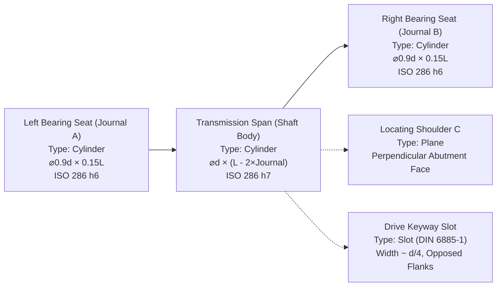
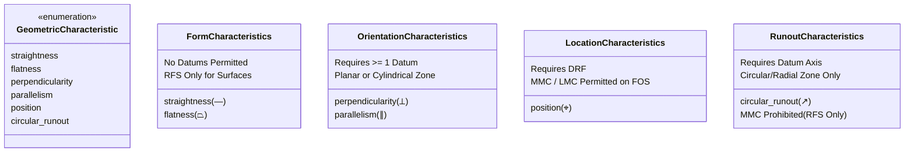

# GD&T & CAD Geometry Integration Engineering Guide

## 1. Executive Summary

This engineering specification establishes the theoretical foundation, software architecture, and validation logic for the **Geometric Dimensioning and Tolerancing (GD&T)** module integrated into the Quantum AI Mechanical Engineering Design Copilot.

The module implements:
1. **Standards-Compliant Feature Control Frame (FCF) Data Models** conforming to **ISO 1101:2017**, **ISO 5459:2011**, and **ASME Y14.5-2018**.
2. **CAD Geometry Feature Normalizer** extracting functional cylindrical seats, locating shoulders, transmission spans, and keyway slots from parametric shaft designs.
3. **Deterministic GD&T Validation Engine** evaluating syntax, datum reference frames (DRF), degrees of freedom (DOF), tolerance zone shapes, and material condition modifiers ($Ⓜ$ / $\text{MMC}$, $Ⓛ$ / $\text{LMC}$, $\text{RFS}$).
4. **Physical Metrology Boundary** explicitly separating geometric tolerance definition validity from coordinate measuring machine (CMM) physical part conformance.
5. **CAD B-Rep Boundary** clarifying browser-runtime limitations regarding direct STEP (ISO 10303-21) and IGES boundary-representation parsing versus normalized JSON feature exchange.

---

## 2. Standards Framework: ISO GPS vs. ASME Y14.5

A primary responsibility of modern engineering design tools is reconciling the fundamental philosophical divergence between International Organization for Standardization (ISO) Geometrical Product Specifications (GPS) and the American Society of Mechanical Engineers (ASME) standard systems:

| Criteria | ISO GPS (ISO 1101:2017 / ISO 8015:2011) | ASME Y14.5-2018 |
| :--- | :--- | :--- |
| **Fundamental Default Principle** | **Independency Principle (ISO 8015)**: By default, size tolerances and geometric tolerances are independent. | **Rule #1 (Envelope Principle)**: By default, the surface or surfaces of a regular feature of size shall not extend beyond a boundary of perfect form at Maximum Material Condition (MMC). |
| **Envelope Invocation** | Requires explicit invocation with the Envelope Symbol $Ⓔ$. | Automatically enforced on regular features of size unless overridden by note (e.g., "PERFECT FORM AT MMC NOT REQD"). |
| **Datum System Reference** | Governed by **ISO 5459:2011** (Extracted integral features, associated features, datum systems). | Governed by **ASME Y14.5-2018 Section 7** (Datum Reference Frames, true geometric counterparts). |
| **Runout Modifier Rules** | RFS is mandatory. Indicators register full indicator movement (FIM / TIR); material modifiers $Ⓜ$ or $Ⓛ$ are strictly prohibited. | RFS is mandatory. Material modifiers $Ⓜ$ or $Ⓛ$ are strictly prohibited. |

---

## 3. Normalized Shaft CAD Geometry Model

The application extracts 5 functional geometric entities from the active transmission shaft parameters ($d, L$):



### Feature Specifications:
1. **Left Journal (`feat-journal-left`)**: Precision ground bearing seat for radial support. Feature of Size: `true`. Primary bearing axis Datum $A$ candidate.
2. **Shaft Body (`feat-shaft-body`)**: Main cylindrical span subject to combined torsional shear and bending stresses. Feature of Size: `true`.
3. **Right Journal (`feat-journal-right`)**: Opposite precision ground bearing seat. Feature of Size: `true`. Secondary bearing axis Datum $B$ candidate.
4. **Gear Locating Shoulder (`feat-gear-shoulder`)**: Planar face perpendicular to the shaft centerline, providing positive axial positioning for the gear hub. Feature of Size: `false` (single planar surface).
5. **Keyway Slot (`feat-keyway`)**: Milled rectangular keyway according to DIN 6885-1. Feature of Size: `true` (opposed parallel flank surfaces).

---

## 4. Datum Reference Frames & Degrees of Freedom

Per **ISO 5459:2011**, a Datum Reference Frame (DRF) locks the 6 degrees of freedom (3 translations: $T_x, T_y, T_z$; 3 rotations: $R_x, R_y, R_z$) of a rigid body:

- **Compound Datum Axis $A-B$**: Formed by the coaxial common axis of the two bearing seats (`journal-left` and `journal-right`). This establishes the functional centerline of rotation and constrains 4 degrees of freedom:
  $$\text{Constrained DOFs}: \{ T_x, T_y, R_x, R_y \}$$
- **Datum Shoulder $C$**: Planar locating shoulder constraining longitudinal translation:
  $$\text{Constrained DOFs}: \{ T_z \}$$
- **Keyway Centerplane**: Constrains rotational orientation ($R_z$) about the shaft axis.

---

## 5. Supported Geometric Characteristics & Validation Rules

The software evaluates 6 core geometric characteristics essential for precision rotating machinery:



### Validation Invariants Enforced by the Engine:
1. **Tolerance Magnitude**: $t > 0.000\text{ mm}$. Values $> 1.0\text{ mm}$ trigger precision advisories; values $< 0.001\text{ mm}$ trigger grinding capability warnings.
2. **Form Independence**: Form controls (`straightness`, `flatness`) MUST NOT reference datums. Any datum reference in a form frame generates a fatal rule violation.
3. **Orientation / Location Datum Dependency**: `perpendicularity`, `parallelism`, `position`, and `circular_runout` MUST reference at least a primary datum or compound axis.
4. **Self-Referential Cycle Detection**: A feature cannot reference a datum established by the feature itself (e.g., `feat-journal-left` referencing Datum $A$).
5. **Material Modifier Compatibility**:
   - `circular_runout` strictly prohibits $Ⓜ$ (MMC) or $Ⓛ$ (LMC).
   - Planar surface controls (`flatness`, planar `perpendicularity` on a shoulder) strictly prohibit $Ⓜ$ / $Ⓛ$ unless applied to a feature of size.
6. **Tolerance Zone Geometry**: Planar faces cannot receive cylindrical ($\varnothing$) tolerance zones.

---

## 6. Physical Metrology & CMM Conformance Boundary

The engine maintains a strict, transparent boundary regarding verification vs physical inspection:

> **Engineering Metrology Disclaimer:**  
> The GD&T Engine deterministically validates the **definition syntax, datum relationships, degrees of freedom, and tolerance zone semantics** against ISO 1101 and ASME Y14.5 standards.  
> **Physical part conformance** cannot be certified by design software without empirical coordinate measuring machine (CMM) point cloud data, dial test indicator (DTI) runout inspection, or optical profilometry scans.

In software data models, all validation results maintain:
```typescript
physicalConformanceStatus: 'unevaluated'
```
preventing premature or fraudulent quality sign-offs.

---

## 7. CAD File Import Architecture & B-Rep Boundaries

The software provides a dedicated file import pipeline for CAD geometric data:

- **JSON Geometric Feature Interchange**: Supported. Accepts structured arrays of `CadFeature` objects, enabling seamless integration with external parametric design tools.
- **Direct STEP (ISO 10303-21) / IGES (.iges) Boundary Representation**:  
  Parsing Boundary-Representation (B-rep) solid geometry models (evaluating trimmed NURBS surfaces, topological shells, face-edge loops, and Brep topology trees) requires a native geometric solid modeling kernel (such as **OpenCASCADE Technology** or Parasolid C++ binaries).  
  Because running a multi-megabyte C++ modeling kernel in the client browser runtime is neither performant nor portable, the system explicitly intercepts `.step`, `.stp`, `.iges`, `.igs`, and `.brep` uploads, returning an accurate diagnostic error:
  ```json
  {
    "success": false,
    "code": "UNSUPPORTED_CAD_BREP",
    "error": "Direct B-rep STEP (ISO 10303-21) and IGES parsing requires a native geometric solid modeling kernel (e.g., OpenCASCADE C++ bindings) which is not executed in the client browser runtime. Please use normalized JSON feature models or active parametric shaft configurations."
  }
  ```
