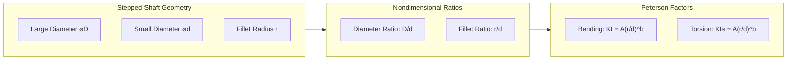
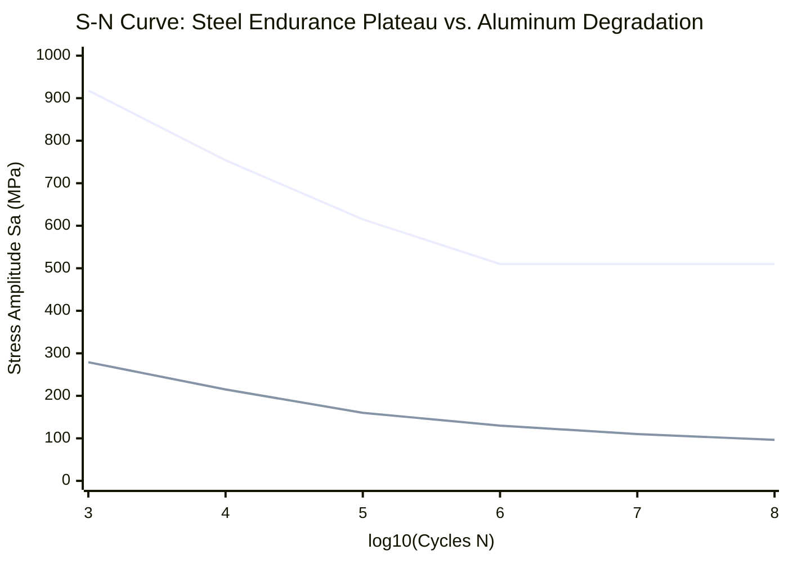

# Stress Concentrations, Notch Sensitivity & Dynamic Fatigue S–N Engineering Guide

## 1. Executive Summary

This engineering manual establishes the theoretical formulations, boundary conditions, and software architecture for **Stage 07: Stress Concentrations, Notch Sensitivity & Dynamic Fatigue S–N Curves** in the Quantum AI Mechanical Engineering Design Copilot.

The implementation unifies:
1. **Elastic Stress Concentration Engine ($K_t, K_{ts}$)** for stepped shafts with shoulder fillets and keyed shaft profiles conforming to **Peterson's Stress Concentration Factors (4th Ed., 2020)** and **Shigley's Mechanical Engineering Design (11th Ed., 2020)**.
2. **Notch Sensitivity Engine ($q, q_s, K_f, K_{fs}$)** applying **Peterson's model** to account for microstructural grain size and plastic notch-root relieving.
3. **Material Fatigue Intelligence & S–N Curve Fitting** using the **Basquin log-log power-law model ($S_a = A N^b$)**, enforcing the strict metallurgical distinction between ferrous endurance plateaus and non-ferrous (aluminum) continuous fatigue degradation.
4. **Marin Endurance Limit Modifiers ($k_a, k_b, k_c, k_d, k_e$)** to compute fully corrected component endurance limits ($S_e$).
5. **Cyclic Loading & Mean-Stress Criteria** evaluating **Modified Goodman**, **Gerber**, **Soderberg**, and **ASME Elliptic** envelopes alongside first-cycle static yield checks ($n_y$).
6. **Standards Registry Audit & Traceability** incorporating ISO 1099, ISO 12107, ASTM E466, recording ASTM E739 as withdrawn (2024), and updating ISO 5459:2011 as historical (superseded by ISO 5459:2024).

---

## 2. Theoretical Elastic Stress Concentration ($K_t, K_{ts}$)

Geometric discontinuities in transmission shafts (shoulder steps, fillet transitions, and keyways) cause localized stress concentrations exceeding nominal section stresses:

$$\sigma_{\text{peak}} = K_t \cdot \sigma_0, \quad \tau_{\text{peak}} = K_{ts} \cdot \tau_0$$

### 2.1 Stepped Shaft with Shoulder Fillet
For a circular shaft stepped from small diameter $d$ to large diameter $D$ with transition fillet radius $r$:

#### Analytical Formulations (Shigley Tables A-15-8 & A-15-9 / Peterson Tables 3.1 & 3.2):
$$K_t = A \cdot \left(\frac{r}{d}\right)^b, \quad K_{ts} = A_s \cdot \left(\frac{r}{d}\right)^{b_s}$$
where coefficients $A$ and $b$ are determined via linear interpolation across $D/d$:

| $D/d$ Ratio | Bending $A$ | Bending $b$ | Torsion $A_s$ | Torsion $b_s$ |
| :--- | :--- | :--- | :--- | :--- |
| **1.05** | 0.94723 | -0.27877 | 0.83425 | -0.21621 |
| **1.10** | 0.95880 | -0.28269 | 0.83332 | -0.23177 |
| **1.20** | 0.97098 | -0.21796 | 0.84634 | -0.23974 |
| **1.30** | 0.98565 | -0.20846 | 0.85500 | -0.24500 |
| **1.50** | 0.93885 | -0.25759 | 0.86900 | -0.25200 |
| **2.00** | 0.90880 | -0.28598 | 0.89002 | -0.24076 |
| **3.00** | 0.89334 | -0.30860 | 0.89700 | -0.23800 |

#### Valid Applicability Domain:
$$1.01 \le \frac{D}{d} \le 3.00, \quad 0.02 \le \frac{r}{d} \le 0.30$$
Inputs outside this domain are rejected with an explicit out-of-range diagnostic. Extrapolation is strictly prohibited.

### 2.2 Keyway Stress Concentrations (Peterson Sec. 6.5, Shigley Table 7-1)
For parallel drive keyways milled according to DIN 6885-1:
- **Profile Keyway (End-Milled)**:
  - Bending: $K_t = 2.14$ for standard corner radius ratio $r_k / d = 0.02$. If $r_k / d < 0.015$, $K_t$ increases to $2.80$.
  - Torsion: $K_{ts} = 3.00$.
- **Sled-Runner Keyway**:
  - Bending: $K_t = 1.70$ (reduced due to gentle transitional runout at cutter exit).
  - Torsion: $K_{ts} = 2.40$.

---

## 3. Notch Sensitivity and Fatigue Concentration ($K_f, K_{fs}$)

Theoretical stress concentration $K_t$ applies strictly to linear elastic static loading. Under cyclic fatigue, localized microstructural plasticity and finite grain dimensions reduce the effective stress concentration to the **fatigue stress concentration factor** $K_f$:

$$K_f = 1 + q(K_t - 1), \quad K_{fs} = 1 + q_s(K_{ts} - 1)$$

where $q$ and $q_s$ are the notch sensitivities ($0 \le q \le 1$).

### Peterson's Notch Sensitivity Model:
$$q = \frac{1}{1 + \frac{a}{r}}$$
where $r$ is the notch root radius in mm, and $a$ is Peterson's material constant in mm:
- **For Steels** ($S_{ut}$ in MPa, Shigley Eq. 6-35a):
  $$a = 0.0254 \cdot \left(\frac{2070}{S_{ut}}\right)^{1.8}\text{ mm}$$
- **For Aluminum Alloys** ($S_{ut}$ in MPa, Shigley Eq. 6-35b):
  $$a = 0.0254 \cdot \left(\frac{345}{S_{ut}}\right)^{2.0}\text{ mm}$$
- **For Torsional Shear ($q_s$)**:
  $$a_s \approx 0.6 \cdot a \implies q_s = \frac{1}{1 + \frac{0.6a}{r}}$$

### Limiting Cases:
1. As $r \to \infty$ (large unnotched radius), $a/r \to 0 \implies q \to 1.0 \implies K_f \to K_t$.
2. When $q \to 0$ (fully insensitive), $K_f = 1.0$.
3. When $K_t = 1.0$ (smooth bar), $K_f = 1.0$ regardless of $q$.

> [!IMPORTANT]
> **Prevention of Double-Counting:**  
> $K_f$ is applied exclusively to the cyclic alternating stress amplitude: $\sigma_a = K_f \cdot \sigma_{a0}$.  
> $K_t$ and $K_f$ are NEVER multiplied together.

---

## 4. Material Fatigue Models and Basquin Log-Log S–N Curves

In the high-cycle fatigue regime ($10^3 \le N \le 10^7$ cycles), stress-life behavior is modeled using the Basquin power-law equation:

$$S_a = A \cdot N^b \iff \log_{10}(S_a) = \log_{10}(A) + b \cdot \log_{10}(N)$$

### 4.1 Metallurgical Reality: Steels vs. Nonferrous Alloys
1. **Ferrous Steels (e.g. AISI 4140, AISI 1045, AISI 4340)**:
   Exhibit a distinct **endurance limit ($S'_e$)** at $N \approx 10^6$ cycles in benign environments due to interstitial carbon/nitrogen strain-aging locking dislocations.
   $$S'_e = 0.5 \cdot S_{ut} \quad (\text{for } S_{ut} \le 1400\text{ MPa})$$
   $$S'_e = 700\text{ MPa} \quad (\text{for } S_{ut} > 1400\text{ MPa})$$
2. **Aluminum Alloys (e.g. 6061-T6, 7075-T6)**:
   **DO NOT possess an endurance limit plateau.** Microscopic cyclic slip persists even at low stress levels. The fatigue strength is defined at an arbitrary cycle threshold (typically $5 \times 10^8$ cycles per the Aluminum Association and MMPDS-01).

---

## 5. Marin Endurance Modification Factors

A real machine component has lower fatigue strength than a polished laboratory rotating-beam specimen ($S'_e$). The fully corrected endurance limit $S_e$ is:

$$S_e = k_a \cdot k_b \cdot k_c \cdot k_d \cdot k_e \cdot k_f \cdot S'_e$$

1. **Surface Finish Factor ($k_a = a \cdot S_{ut}^b$)**:
   - Ground: $a = 1.58, b = -0.085$
   - Machined / Cold-drawn: $a = 4.51, b = -0.265$
   - Hot-rolled: $a = 57.7, b = -0.718$
   - As-forged: $a = 272.0, b = -0.995$
2. **Size Factor ($k_b$) for Rotating Circular Shafts**:
   - For $2.79\text{ mm} \le d \le 51\text{ mm}$: $k_b = 1.24 \cdot d^{-0.107}$
   - For $51\text{ mm} < d \le 254\text{ mm}$: $k_b = 1.51 \cdot d^{-0.157}$
   - For Axial: $k_b = 1.0$
3. **Loading Factor ($k_c$)**:
   - Bending: $k_c = 1.0$
   - Axial: $k_c = 0.85$
   - Torsion: $k_c = 0.59$ (Distortion energy relation $S_{se} = 0.577 S_e \approx 0.59$)
   - Combined (von Mises normalized): $k_c = 1.0$
4. **Temperature Factor ($k_d$)**:
   For $20^\circ\text{C} \le T \le 450^\circ\text{C}$:
   $$k_d = 0.975 + 0.432 \times 10^{-3} T - 0.115 \times 10^{-5} T^2 + 0.104 \times 10^{-8} T^3 - 0.595 \times 10^{-12} T^4$$
   Temperatures $> 450^\circ\text{C}$ trigger high-temperature creep advisories.
5. **Reliability Factor ($k_e$)**:
   $50\% \to 1.000$; $90\% \to 0.897$; $95\% \to 0.868$; $99\% \to 0.814$; $99.9\% \to 0.753$.

---

## 6. Cyclic Loading, Mean-Stress Criteria & Life Prediction

Constant-amplitude cyclic loading decomposes into alternating and mean components:

$$\sigma_a = \frac{\sigma_{\max} - \sigma_{\min}}{2}, \quad \sigma_m = \frac{\sigma_{\max} + \sigma_{\min}}{2}, \quad R = \frac{\sigma_{\min}}{\sigma_{\max}}$$

### 6.1 First-Cycle Static Yield (Langer Line)
$$\sigma_{\text{peak,unrelaxed}} = \sigma_m + K_f \sigma_a$$
$$n_y = \frac{S_y}{\sigma_{\text{peak,unrelaxed}}}$$
If $n_y < 1.0$, first-cycle static yield failure occurs regardless of fatigue life.

### 6.2 Mean-Stress Failure Criteria (Tensile $\sigma_m > 0$)
1. **Modified Goodman**:
   $$\frac{\sigma_a}{S_e} + \frac{\sigma_m}{S_{ut}} = \frac{1}{n_f} \implies n_f = \frac{1}{\frac{\sigma_a}{S_e} + \frac{\sigma_m}{S_{ut}}}$$
2. **Gerber (Parabolic)**:
   $$\frac{\sigma_a}{S_e} + \left(\frac{\sigma_m}{S_{ut}}\right)^2 \cdot n_f = \frac{1}{n_f}$$
3. **Soderberg (Conservative Yield Bounded)**:
   $$\frac{\sigma_a}{S_e} + \frac{\sigma_m}{S_y} = \frac{1}{n_f}$$
4. **ASME Elliptic**:
   $$\left(\frac{\sigma_a}{S_e}\right)^2 + \left(\frac{\sigma_m}{S_y}\right)^2 = \frac{1}{n_f^2}$$

### 6.3 Compressive Mean Stress ($\sigma_m \le 0$)
Compressive mean stresses inhibit micro-crack propagation. In accordance with ASTM and Shigley standards:
$$n_f = \frac{S_e}{\sigma_a}$$

### 6.4 Finite Life Estimation
Equivalent fully reversed stress (Goodman):
$$\sigma_{rev} = \frac{\sigma_a}{1 - \frac{\sigma_m}{S_{ut}}}$$
Reversible cycle count:
$$N = \left(\frac{\sigma_{rev}}{A}\right)^{1/b}$$
- If $\sigma_{rev} \le S_e$ and material has an endurance plateau: Life is **Infinite ($N > 10^6$ cycles)**.
- If $N < 10^3$ cycles: Flagged as **Low-Cycle Fatigue (LCF)** out of domain.
- Operating hours: $t_{\text{hours}} = \frac{N}{60 \cdot \text{RPM}}$ (assuming 1 rotation = 1 stress cycle in rotating bending).
